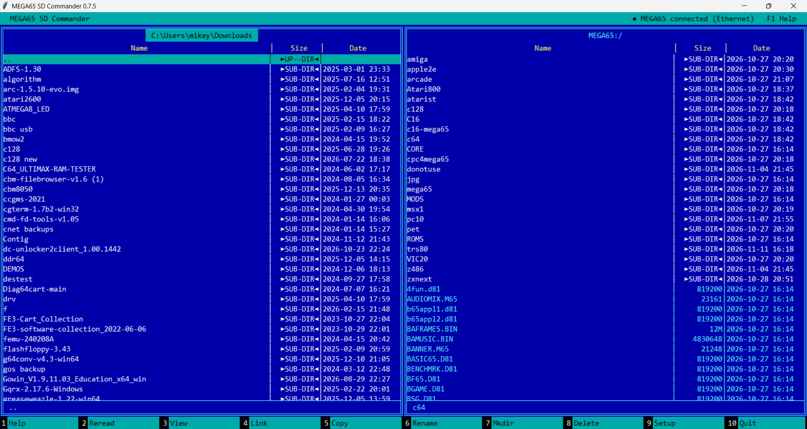

# MEGA65 SD Commander 0.7.5

A Norton Commander-style file manager for the MEGA65's SD card over Ethernet.
Either panel can show a PC drive, the MEGA65 SD card (over Ethernet) or the EXP Board SD card
(the MEGA65 Expansion Board Integrated JTAG's own SD card, over WiFi).

## Installing

See **[INSTALL.md](INSTALL.md)** for what to install first (Python and mega65_ftp), how to
prepare the MEGA65 (DIP switch 2, `ETHLOAD.M65`, SHIFT + £ for remote control) and, if you
have one, how to set up the MEGA65 JTAG Expansion Board.

Then start **Start MEGA65 SD Commander.bat** (or `python m65_sd_commander.py`).

## Use

Have the MEGA65 at the READY prompt with remote control on (**SHIFT + £**, power LED blinking
green/yellow), then press **F4** to connect.

| Key | Action |
|---|---|
| Tab / ← → | Switch panel |
| Enter / Backspace | Open folder / parent folder |
| Space, Insert, right-click | Mark / unmark (+ / - = all / none) |
| Enter on .bit / .cor / .m65j | Launch it on the MEGA65 through the JTAG expansion board. A core on the MEGA65 SD card is copied to a temp folder on the PC first |
| Enter on a .zip | Open it like a folder (PC panel). Mark files/folders inside and F5 extracts them to the other panel. Backspace leaves the ZIP |
| X on a .zip | Extract the whole ZIP into a new folder named after it (`games.zip` -> `games`) in the other panel. If the ZIP already holds a single folder with that name it isn't doubled up. Works for ZIPs on the PC, MEGA65 or EXP board |
| F2 / Ctrl+R | Reread folder |
| F3 | View the file under the cursor: Text (UTF-8 / Windows), PETSCII, C64 BASIC listing or Hex. In the viewer: F2 wrap, F4 mode, F7 search, F8 C64 character set, Esc/F3/F10 close |
| F4 | Connect / disconnect the MEGA65 |
| Ctrl+L | mega65_ftp log |
| F5 | Copy marked items to the other panel, between any two of PC / MEGA65 / EXP board (whole folders too; MEGA65 <-> EXP board goes through a temp folder on the PC) |
| F6 / F7 / F8 | Rename / Make folder / Delete (folders recursively) |
| F9 / F10 | Setup / Quit |
| Alt+F1 / Alt+F2 | Choose what the left / right panel shows: MEGA65 SD card, EXP Board SD card or a PC drive (or click a panel's title) |

## Good to know

- While connected the MEGA65 is running mega65_ftp's helper. F4 or quitting hands it back.
- Speed is whatever mega65_ftp's Ethernet transfer gives you.
- **Files must be under 2 GB** to go to or from the MEGA65 SD card. That's a limit inside
  mega65_ftp (it stores file sizes in 32-bit numbers). Bigger files are skipped with a message.
- Names are sent to the MEGA65 as plain ASCII; other characters become `_`.
- If auto-discovery can't find the MEGA65, put its address in Setup as
  `fe80::xxxx:xxxx:xxxx:xxxx%<interface number>`.
- Settings are saved in `.m65sd.config` next to the program.
- **No JTAG expansion board?** Untick "I have the MEGA65 JTAG expansion board" in Setup (F9).
  The EXP Board SD card and core launching are then hidden. It's ticked automatically
  the first time only if a board address is found in `.m65j.config`.
- Launching cores uses the expansion board address and login from your `.m65j.config`
  (next to the app, or in your home folder), the same file `m65j.py` uses.
  You can override it in Setup (F9). Launching replaces the running core, so the
  MEGA65 connection is closed first. Press F4 again once the MEGA65 core is back.

## Disk images (.D64 / .D71 / .D81)

- Enter opens one like a folder, read only, in the order the C64 lists it, with blocks and file
  types (PRG, SEQ, USR, REL, DEL, CBM). On `..` the status line shows the disk name, ID and
  blocks free.
- The directory is drawn in real C64 characters, so graphics characters in file names
  show properly (and control codes appear reversed, as on a C64). **F8** switches between
  upper case/graphics and lower/upper case (disk images are read only, so F8 can't delete
  anything there - the key bar shows "Charset").
- 1581 partitions with their own directory open like folders.
- F5 extracts marked files as `NAME.prg`, `NAME.seq`, ... (partitions become folders).
- Enter (or F3) on a file inside views it - a BASIC program is listed like `LIST`.
- Disk images and ZIPs on the MEGA65 or EXP board open too: they're copied to a temp folder
  first, and Backspace takes you back.

## C64 character set in the viewer

The viewer's BASIC and PETSCII modes use the real C64 characters, in C64 colours: graphics
characters, reverse video, and control codes inside quotes shown reversed the way `LIST` shows
them. F8 switches between the upper case/graphics and lower/upper case sets.

The font is **C64 Pro Mono** by Style (https://style64.org/c64-truetype), in `fonts/`. It's
included unmodified under its licence (`fonts/license.txt`), which allows that only for software
given away free. It's loaded just for this program and nothing is installed. Without it, the
viewer falls back to plain text.

## ZIP files

- Extracting works to a PC folder, the MEGA65 SD card or the EXP Board SD card.
- To the EXP board, only the `.bit`/`.cor`/`.m65j` files come out, flattened into the current
  board folder (the board can't hold folders or other file types).
- Enter on a core inside a ZIP launches it directly.
- ZIP entries that try to write outside the target folder (`../` or absolute paths) are ignored.

## EXP Board SD card limits

These come from the board's firmware:

- It only stores `.bit`, `.cor` and `.m65j` files. Other files are skipped when copying to it.
- It can't make folders, rename, or delete folders. Copying *from* it works for whole folders.
- Its address and login come from `.m65j.config`, or from Setup (F9).
- Current board firmware cuts off folder listings bigger than about 11.5 KB (its network
  send buffer). SD Commander uses whatever arrived; if rows were lost it tells you.

## Files

- `m65_sd_commander.py` – the GUI
- `m65cbm.py` – reads D64/D71/D81 images, PETSCII text and C64 BASIC (no GUI code)
- `m65board.py` – launches cores via the expansion board's web interface (reads `.m65j.config`)
- `m65ftp.py` – a reusable wrapper around mega65_ftp (no GUI code)
